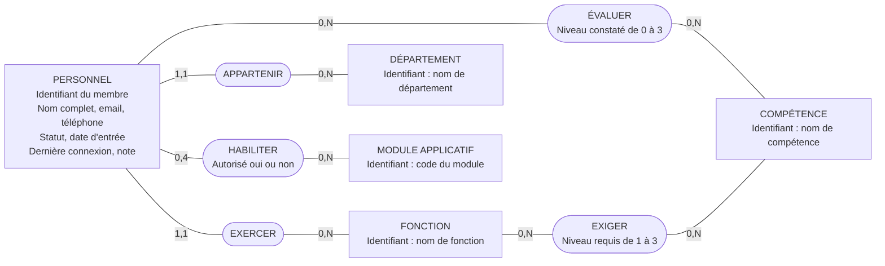
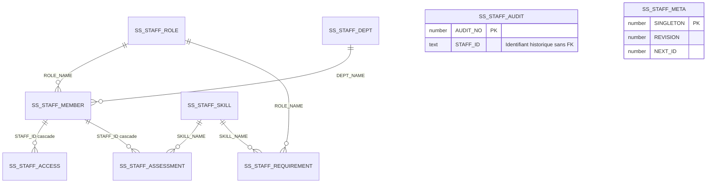

# Modèles de données Gestion Staff

**Projet SkySense · Donia · 15 octobre 2026**

Ce document décrit le module Staff actuellement développé dans `staff/` et son
schéma Oracle. Il fournit sa contribution au dossier de conception commun :
modèle conceptuel, modèle relationnel et correspondance avec le script physique.
Le modèle commun des cinq modules reste à assembler avec les autres membres de
l'équipe, après validation des relations entre leurs entités.

## Comprendre les trois modèles

| Livrable | Question traitée | Exemple dans Staff |
| --- | --- | --- |
| MCD, modèle conceptuel des données | Quelles informations métier et quelles associations ? | Un membre exerce une fonction ; une fonction peut être exercée par plusieurs membres. |
| MLD, modèle logique relationnel | Quelles tables, clés primaires et clés étrangères ? | `SS_STAFF_MEMBER.ROLE_NAME` référence `SS_STAFF_ROLE.ROLE_NAME`. |
| MPD, modèle physique | Comment créer ces tables dans Oracle ? | `ROLE_NAME NVARCHAR2(80) NOT NULL REFERENCES SS_STAFF_ROLE(ROLE_NAME)`. |

La clé primaire (PK) identifie une ligne. La clé étrangère (FK) référence une
clé d'une autre table. `(1,1)` signifie exactement une occurrence ; `(0,N)`
signifie aucune ou plusieurs ; `(0,4)` signifie au plus quatre.

## MCD du fonctionnement actuellement livré

L'entité principale de Donia est **Personnel**. Les fonctions, départements,
compétences et associations soutiennent son CRUD et ses fonctionnalités avancées.
Ils ne constituent pas de nouveaux modules attribués à d'autres étudiants.

**Règles de gestion**

1. Chaque membre possède une fonction et un département. Une fonction ou un
   département peut exister sans membre.
2. L'email est obligatoire et unique sans distinction de casse.
3. Un membre possède au plus une évaluation par compétence. L'absence
   d'évaluation signifie « non évalué », pas un niveau zéro.
4. Une fonction possède au plus une exigence par compétence. Le besoin en
   formation est calculé à partir de l'écart entre les niveaux requis et évalués.
5. Un membre possède au plus un droit pour chacun des quatre codes Stations,
   Equipment, Maintenance et Services. L'application enregistre quatre droits
   à chaque sauvegarde ; le schéma autorise de zéro à quatre lignes par membre.
6. Un membre inactif conserve ses droits configurés, mais l'application calcule
   tous ses droits effectifs comme refusés. Active/Inactive ne décrit pas sa
   disponibilité à une date donnée.
7. La suppression d'un membre supprime ses droits et évaluations. Le journal
   conserve les événements, avec l'identifiant et le nom du membre à l'époque.

Le module applicatif est un domaine métier de quatre valeurs, implémenté par
un `CHECK` sur `MODULE_CODE` ; il n'existe pas de table `MODULE` dans cette version.
Le journal mémorise des informations historiques sans FK vers une fiche qui
peut être supprimée. Les paramètres techniques de synchronisation ne figurent
pas dans le MCD métier.

## MLD correspondant aux neuf tables existantes

| Table | Colonnes | Clé primaire | Références |
| --- | --- | --- | --- |
| `SS_STAFF_MEMBER` | `STAFF_ID`, `FULL_NAME`, `EMAIL`, `PHONE`, `ROLE_NAME`, `DEPT_NAME`, `STATUS`, `JOINED_ON`, `LAST_LOGIN`, `NOTE` | `STAFF_ID` | `ROLE_NAME` → ROLE ; `DEPT_NAME` → DEPT |
| `SS_STAFF_ROLE` | `ROLE_NAME`, `HAS_REQUIREMENTS` | `ROLE_NAME` | Aucune |
| `SS_STAFF_DEPT` | `DEPT_NAME` | `DEPT_NAME` | Aucune |
| `SS_STAFF_SKILL` | `SKILL_NAME` | `SKILL_NAME` | Aucune |
| `SS_STAFF_ACCESS` | `STAFF_ID`, `MODULE_CODE`, `IS_ALLOWED` | (`STAFF_ID`, `MODULE_CODE`) | `STAFF_ID` → MEMBER, suppression en cascade |
| `SS_STAFF_REQUIREMENT` | `ROLE_NAME`, `SKILL_NAME`, `REQUIRED_LEVEL` | (`ROLE_NAME`, `SKILL_NAME`) | `ROLE_NAME` → ROLE ; `SKILL_NAME` → SKILL |
| `SS_STAFF_ASSESSMENT` | `STAFF_ID`, `SKILL_NAME`, `ASSESSED_LEVEL` | (`STAFF_ID`, `SKILL_NAME`) | `STAFF_ID` → MEMBER, suppression en cascade ; `SKILL_NAME` → SKILL |
| `SS_STAFF_AUDIT` | `AUDIT_NO`, `ACTION_AT_UTC`, `OPERATOR_NAME`, `STAFF_ID`, `MEMBER_NAME`, `ACTION_NAME`, `DETAILS` | `AUDIT_NO` | Aucune : conservation de l'historique |
| `SS_STAFF_META` | `SINGLETON`, `SCHEMA_VERSION`, `REVISION`, `NEXT_ID` | `SINGLETON` | Aucune : table technique |

Les noms abrégés ROLE, DEPT, MEMBER et SKILL dans la dernière colonne désignent
les tables préfixées `SS_STAFF_` correspondantes. Toutes les FK référencent la
colonne de même nom. `HAS_REQUIREMENTS` distingue un référentiel explicitement
configuré, même vide, de l'absence de référentiel enregistré.

## MPD Oracle

Le script physique complet est [oracle_staff.sql](oracle_staff.sql). Il crée
les neuf tables, leurs contraintes, l'index unique sur `LOWER(EMAIL)` et la ligne
initiale de configuration. Il est déjà exécuté dans le schéma DONIA de XEPDB1.
Pour dessiner le modèle, importer ses métadonnées ou ce fichier DDL ; il n'est
pas nécessaire de réexécuter les `CREATE TABLE` dans la base existante.

| Colonnes | Types Oracle et contraintes principales |
| --- | --- |
| Identifiant de membre, noms de fonction/département/compétence | `NVARCHAR2(80)` ; PK ou FK selon la table |
| `FULL_NAME` | `NVARCHAR2(100) NOT NULL` |
| `EMAIL` | `NVARCHAR2(254) NOT NULL` ; index unique sur `LOWER(EMAIL)` |
| `PHONE`, `NOTE` | `NVARCHAR2(40)`, `NVARCHAR2(1000)` ; facultatifs |
| `STATUS` | `VARCHAR2(8) NOT NULL` ; Active ou Inactive |
| `JOINED_ON`, `LAST_LOGIN` | `DATE`, `TIMESTAMP(0)` ; facultatifs dans le schéma |
| `MODULE_CODE` | `VARCHAR2(20)` ; quatre valeurs autorisées ; partie de PK |
| `IS_ALLOWED`, `HAS_REQUIREMENTS` | `NUMBER(1) NOT NULL` ; 0 ou 1 |
| `REQUIRED_LEVEL`, `ASSESSED_LEVEL` | `NUMBER(1) NOT NULL` ; respectivement 1 à 3 et 0 à 3 |
| `AUDIT_NO`, `ACTION_AT_UTC` | `NUMBER(10)` PK ; `TIMESTAMP(3) NOT NULL` |
| `OPERATOR_NAME`, `MEMBER_NAME`, `ACTION_NAME`, `DETAILS` | `NVARCHAR2(256) NOT NULL`, `NVARCHAR2(100)`, `NVARCHAR2(100) NOT NULL`, `CLOB` |
| `SINGLETON`, `SCHEMA_VERSION`, `REVISION`, `NEXT_ID` | `NUMBER(1)`, `NUMBER(3)`, `NUMBER(10)`, `NUMBER(10)` ; singleton 1, version 1, révision ≥ 0, prochain numéro > 0 |

Les identifiants et la révision sont gérés par l'application sous transaction.
Le script actuel n'utilise ni séquence ni trigger pour générer `STAFF_ID`.
L'opérateur du journal est la session Windows ; la table n'est pas un compte
de connexion à l'application.

## Dessiner dans Oracle Data Modeler

Oracle Data Modeler peut importer le dictionnaire de données pour construire
les modèles relationnel et physique d'une base existante, puis en dériver un
modèle logique. Les cardinalités métier du MCD doivent ensuite être revues.

1. Dans SQL Developer, ouvrir **Fichier > Data Modeler > Importer > Dictionnaire
   de données**. Dans l'application Data Modeler autonome, utiliser **Fichier >
   Importer > Dictionnaire de données**. Les libellés peuvent être en anglais.
2. Choisir la connexion `skysense_staff`, puis le schéma `DONIA`.
3. Sélectionner les neuf tables `SS_STAFF_*` et terminer l'import.
4. Réorganiser le diagramme pour lire les PK, les FK et leurs relations.
   AUDIT et META sont volontairement sans lien de FK vers les autres tables.
5. Enregistrer le design Data Modeler et ses fichiers associés. Produire une
   image lisible du diagramme pour le cahier.
6. Pour le MCD, reprendre les entités et associations métier décrites plus haut,
   en distinguant les tables techniques et les choix de stockage.

Référence : [Oracle Data Modeler — import du dictionnaire et modèles](https://docs.oracle.com/database/sql-developer-data-modeler-17.4/DMDUG/data-modeler-concepts-usage.htm).

## Préparer le modèle commun avec l'équipe

La liste du cahier contient Station, Équipement, Intervention, Personnel et
Service. Pour chaque module, récupérer les entités, attributs, PK, FK et règles
de gestion validées, ou le script `CREATE TABLE` déjà utilisé par son auteur.

| Module | Contribution à rassembler |
| --- | --- |
| Personnel | Ce document et `oracle_staff.sql` |
| Stations | Attributs complets, identifiant, localisation et règles de statut |
| Équipements | Table et clé validées ; le cahier V9 désigne le numéro de série comme PK |
| Maintenance | Intervention, planning, priorité, statut et éventuelles affectations validées |
| Services | Service, tâches, durées, priorités et éventuelles relations validées |

Les affectations Personnel–Intervention, Équipement–Station et les liens avec
Services doivent être décidés avec leurs auteurs. Il faut préciser le nombre
d'objets autorisés de chaque côté, les champs obligatoires et le comportement
à la suppression avant de créer des FK communes. Ces liens ne sont pas ajoutés
au schéma Staff existant par ce document.

La livraison commune doit réunir un MCD avec les cardinalités validées, un MLD
avec toutes les PK/FK, puis le MPD Oracle et les scripts de création cohérents.

## Aligner le cahier et le code

La version V9 du cahier dans Downloads décrit encore un nom/prénom séparé,
les périodes d'indisponibilité, I1 disponibilité et I2 synthèse de charge.
Le projet Staff actuel stocke `FULL_NAME`, n'a pas de table d'indisponibilité et
contient Skills & Training pour le nouveau I2 demandé. La synthèse de charge
a été reclassée avec les statistiques dans l'échange pédagogique.

La ligne Personnel du cahier doit être mise à jour avec la formulation I2
« Identifier les besoins en formation en comparant les compétences évaluées
aux compétences requises par la fonction ». I1 disponibilité reste un travail
distinct à traiter si cette exigence est maintenue. Aucun MCD ne doit présenter
ces périodes comme déjà stockées dans la version Oracle actuelle.

Sources : `staff/EXIGENCES_STAFF.md`, `staff/FORMATION_STAFF.md`,
`staff/database/oracle_staff.sql` et la section 2.1 du cahier
`SkySense_Cahier_Client_FINAL_V9 (1) (1).docx` fourni dans Downloads.

## Vérification et versionnement

Le contrôle en lecture seule du 15 octobre 2026 confirme les neuf tables dans
DONIA, 12 membres et l'absence de la fiche d'essai STF-2026-013 après son retrait
depuis Qt. Les quatre opérations CRUD ont été confirmées par Donia.

Les changements Oracle, les tests, le correctif Delete et ce document sont
regroupés sur la branche individuelle `gestion-staff`. La livraison comprend
les sources, le script SQL et les modèles ; les builds, caches, données privées
et mots de passe sont exclus du versionnement.
